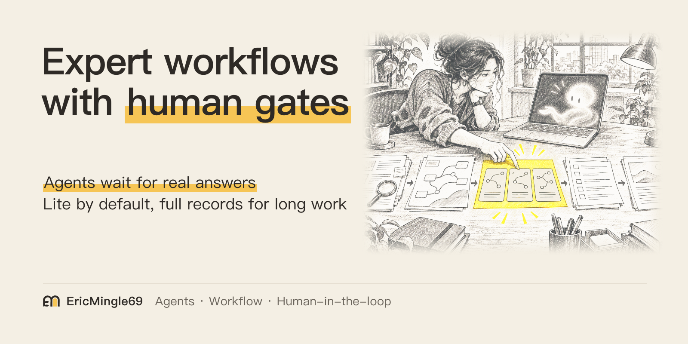

<picture>
  <source media="(prefers-color-scheme: dark)" srcset="readme-assets/cover-en-dark.png">
  
</picture>

<p align="center">
  <a href="skill/expert-process/SKILL.md">Skill entry (Chinese)</a> ·
  <a href="skill/expert-process/references/workflow.md">Full workflow (Chinese)</a> ·
  <a href="ACKNOWLEDGEMENTS.md">Sources and acknowledgements</a> ·
  <a href="upstream/SOURCES.json">Source metadata</a> ·
  <a href="https://github.com/Ming-Sir-69">Author</a>
</p>

<p align="center">
  <a href="LICENSE"></a>
  
  
  
  
</p>

<p align="center">
  <a href="README.md">简体中文</a> · <b>English</b>
</p>

# Expert Process · Professional workflows, external records and human gates for agents

Expert Process v0.4 provides a shared method core, 10 reference guides, a standard-library CLI and record templates for design, development, documentation, analysis and planning. The agent selects methods for the knowledge gaps and collaboration needs of the current problem. Lite handling is the default; full records are available for long, multi-stage work or handoffs. The project is not tied to a model provider or external memory service.

## Features

**Professional judgment, record format and execution tools are selected separately.** Lite and full modes use the same completion standard. Stage, record and card counts do not replace the actual deliverable.

| Mode | When to use it | Record format |
|---|---|---|
| Lite (default) | A local fix, one-off analysis, defined small deliverable, or a single missing capability | Work in the current conversation or project without a record; for resumption, create one `任务.md` and `.eca.json` |
| Full | Long or multi-stage work, complex dependencies, or handoffs that one record cannot support | Four living documents: `1_简报.md`, `2_作战图.md`, `3_日志.md` and `4_验收复盘.md` |

- **Methods selected by gap**: research, integration, human gates, review, retrospectives and skill packaging can be used independently. A single high-risk action strengthens only its relevant evidence, permission and recovery constraints.
- **Runtime data stays outside the source tree**: tasks, the card library and exports go to an explicitly selected external data directory. The CLI refuses to write runtime data or exports back into the tool source tree.
- **Human gates retain their actual state**: options and a default can be registered before a question, and answers are appended as events. Silence, cancellation and timeout are not recorded as answers or authorization.
- **Local cards for optional reuse**: process, expert and preference cards remain under the same external data root. `cross-project` describes scope; it does not trigger a global write or remote synchronization.
- **Two distribution and adapter forms**: the full repository contains the CLI, templates and tools; `pack` exports a method Skill ZIP and a single-file edition. The ChatGPT adapter is separate plain-text material.

## Quick start

Python 3.9 or later is required; the CLI uses only the standard library. Run these commands from the repository root. `guide` is read-only and creates neither a task nor a data directory:

```sh
git clone https://github.com/Ming-Sir-69/expert-process.git
cd expert-process
python3 cli/eca.py --version
python3 cli/eca.py guide
python3 cli/eca.py guide full
```

The [Skill entry](skill/expert-process/SKILL.md) can also be given to an agent, with reference guides loaded for the current gap. The CLI does not register a global workflow, change agent rules or connect to Engram.

To persist a task, explicitly select a data root outside the source tree:

```sh
python3 cli/eca.py --data-dir /path/to/expert-process-data new example --mode lite --title "Local fix"
python3 cli/eca.py --data-dir /path/to/expert-process-data status
python3 cli/eca.py --data-dir /path/to/expert-process-data new migration --mode full --title "Multi-stage migration"
```

Under one data root, `runs/` stores tasks, `library/` stores optional cards and `dist/` stores default exports. Changing the data root does not migrate or publish existing records.

## Usage

The data directory is selected in this order: command-line `--data-dir` → `ECA_DATA_DIR` environment variable → `data_dir` in the user configuration → platform default. The configuration file defaults to `${XDG_CONFIG_HOME:-~/.config}/expert-process/config.json` and can be overridden with `ECA_CONFIG_FILE`. Relative paths from the command line and environment are resolved from the current working directory; relative paths in the configuration are resolved from the configuration file's directory.

| Platform | Default data directory |
|---|---|
| macOS | `~/Library/Application Support/expert-process` |
| Linux | `${XDG_DATA_HOME:-~/.local/share}/expert-process` |
| Windows | `%LOCALAPPDATA%/expert-process` |

<details>
<summary><b>11 CLI subcommands</b></summary>

For each command, `--data-dir` can precede the subcommand; `guide` does not need to write to the data root.

```sh
python3 cli/eca.py guide [lite|full]
python3 cli/eca.py new <slug> --mode lite
python3 cli/eca.py new <slug> --mode full
python3 cli/eca.py status [run]
python3 cli/eca.py gate [run] --id G1 --title … --gave … --counterfactual …
python3 cli/eca.py gate [run] --id G1 --resolve --answer … --changed 是 --writeback …
python3 cli/eca.py card <process|expert|preference> <id> [run]
python3 cli/eca.py find <keyword>
python3 cli/eca.py save [run]
python3 cli/eca.py index
python3 cli/eca.py check [path] [--strict]
python3 cli/eca.py stats [--json]
python3 cli/eca.py pack
python3 cli/eca.py pack --output-dir /path/to/distribution
```

`new` creates a lite record by default. `check --strict` treats structural warnings as failures; `stats` separates preregistered, retrospective, unknown and pending gates. See the [gate rules](skill/expert-process/references/gates.md) for complete parameters and gate semantics (Chinese).

</details>

`pack` includes only the general methods and `LICENSE`, `NOTICE` and `ACKNOWLEDGEMENTS.md`. It excludes task data, the card library, CLI, templates and tool scripts. Keep the full repository for command-line automation. For ChatGPT, upload the [expert methods](adapters/chatgpt/专家方法.md) to a shared capability area in Library and use the [entry instruction](adapters/chatgpt/入口指令.txt) as needed; the current session determines what can actually be read.

## Design

- **Shared core**: define the goal, constraints and completion conditions, then fill the current gap in domain evidence, professional perspective or user-specific information. The method structure draws on the scope, evidence, construction and verification ideas in DisCo / AREX-Skill, reorganized and reduced for this project.<sup>[[1]](#references)</sup>
- **Stages and conflicts**: a full record uses one stage table for goal, input, responsibility, process, output, acceptance, handoff and state. Multi-source conflict handling is adapted from a pinned Skill Seekers revision without its workflow engine.<sup>[[2]](#references)</sup>
- **Progressive disclosure**: the Skill entry selects lite or full handling before loading references for the current gap. Skill structure, degrees of freedom and structural checks draw on a pinned OpenAI skill-creator revision; the checks are reimplemented with the Python standard library.<sup>[[3]](#references)</sup>
- **Interrupt and resume**: a gate stores its pending state, waits for an external answer and appends a resume event. This draws on interrupt and input mechanisms in LangGraph and Claude Code, and user-input conventions in Codex App Server. Their runtimes are not included.<sup>[[4]](#references)[[5]](#references)[[6]](#references)</sup>
- **Deterministic checks**: `tools/colormetrics.py` provides WCAG contrast, OKLab/OKLCH metrics and red/green color-vision-deficiency simulation using published formulas or numerical tables from WCAG, OKLab and Machado et al.<sup>[[7]](#references)[[8]](#references)[[9]](#references)</sup>
- **Traceable sources**: the [source manifest](upstream/SOURCES.json) records paths, sizes and hashes for 352 files across 3 pinned upstream revisions. It contains metadata only, not the upstream source trees.

Earlier four-file and v0.2 records remain readable through `status`, `check` and `stats`; `gate` cannot append a new gate to a v0.2 record. Lite records are not converted to full records automatically.

## Limitations

- The CLI checks record, card and Skill structure. It does not verify domain judgment, professional quality, user acceptance or action authorization; model self-assessment is not user acceptance.
- “Changed direction” in `stats` is a retrospective label, not evidence of improved quality or causal benefit. The repository provides no quantitative controlled evaluation of method effectiveness.
- The project contains no model inference, automatic host registration, external memory service, MCP service or automatic upload. The ChatGPT adapter does not call the local CLI and can use only material visible to the current session.
- The standalone Skill package excludes the CLI, templates and deterministic tools. Commands from the full toolkit cannot be assumed to work in that package.
- The source manifest supports attribution and research review. It does not mean that this project copied, ran or verified all 352 upstream files.

## Development

Tests use isolated data and do not access actual user tasks. Structural checks and exports should also use a separate verification data root:

```sh
python3 cli/tests/test_eca.py
python3 cli/eca.py --data-dir /path/to/verification-data check --strict
python3 cli/eca.py --data-dir /path/to/verification-data pack --output-dir /path/to/distribution
```

`check --strict` covers Skill structure and the records and cards under the selected data root. `pack` checks that license and attribution files are present. Generated files are not uploaded automatically; new files and source boundaries still require review before a public commit.

## Acknowledgements

The cover illustration was generated with an OpenAI image-generation model and processed by this project.

Acknowledgements to the Python open-source project for the runtime and standard library. The workflow, card structure and checking tools draw on pinned revisions of [DisCo / AREX-Skill](https://github.com/VectorSpaceLab/AREX-Skill), [Skill Seekers](https://github.com/yusufkaraaslan/Skill_Seekers) and [OpenAI skill-creator](https://github.com/openai/skills/tree/49f948faa9258a0c61caceaf225e179651397431/skills/.system/skill-creator).<sup>[[1]](#references)[[2]](#references)[[3]](#references)</sup>

See [Sources and acknowledgements](ACKNOWLEDGEMENTS.md) and [NOTICE](NOTICE) for contributions, adaptation scope and upstream licenses. These sources do not imply endorsement by the upstream projects.

## References

1. VectorSpaceLab. *DisCo / AREX-Skill*, revision `ac3fe1afa80fb9a09775ecfb2b6cc3ba850a2db6`. <https://github.com/VectorSpaceLab/AREX-Skill/tree/ac3fe1afa80fb9a09775ecfb2b6cc3ba850a2db6>
2. Karaaslan, Y. *Skill Seekers*, revision `5b5d8dfca263fa76e6daae9f292890b311ef36aa`: `complex-merge.yaml`. <https://github.com/yusufkaraaslan/Skill_Seekers/blob/5b5d8dfca263fa76e6daae9f292890b311ef36aa/src/skill_seekers/workflows/complex-merge.yaml>
3. OpenAI. *skill-creator*, revision `49f948faa9258a0c61caceaf225e179651397431`. <https://github.com/openai/skills/tree/49f948faa9258a0c61caceaf225e179651397431/skills/.system/skill-creator>
4. LangChain. *LangGraph documentation: Interrupts*. <https://docs.langchain.com/oss/python/langgraph/interrupts>
5. Anthropic. *Claude Agent SDK: User input*. <https://code.claude.com/docs/en/agent-sdk/user-input>
6. OpenAI. *Codex App Server documentation: User input requests*. <https://learn.chatgpt.com/docs/app-server>
7. W3C. *Web Content Accessibility Guidelines (WCAG) 2.2: Contrast ratio*. <https://www.w3.org/TR/WCAG22/#dfn-contrast-ratio>
8. Ottosson, B. *A perceptual color space for image processing*. <https://bottosson.github.io/posts/oklab/>
9. Machado, G. M., Oliveira, M. M., & Fernandes, L. A. F. (2009). A Physiologically-based Model for Simulation of Color Vision Deficiency. *IEEE Transactions on Visualization and Computer Graphics*, 15(6), 1291–1298. Numerical values: author page, Table 1, severity 1.0. <https://www.inf.ufrgs.br/~oliveira/pubs_files/CVD_Simulation/CVD_Simulation.html>

## Related work

These works support method comparison and background reading. Their inclusion does not mean that this repository implements them or contains their model-training or inference mechanisms.

1. Shinn, N., Cassano, F., Berman, E., Gopinath, A., Narasimhan, K., & Yao, S. (2023). Reflexion: Language Agents with Verbal Reinforcement Learning. *NeurIPS 2023*. <https://arxiv.org/abs/2303.11366>. Turning task feedback into reflections available to later attempts relates to this project's retrospective and resumption discussions.
2. Madaan, A., et al. (2023). Self-Refine: Iterative Refinement with Self-Feedback. *NeurIPS 2023*. <https://arxiv.org/abs/2303.17651>. The cycle of generation, feedback and revision relates to review and revision as needed; this project does not bundle that inference loop.
3. Shankar, S., Zamfirescu-Pereira, J. D., Hartmann, B., Parameswaran, A., & Arawjo, I. (2024). Who Validates the Validators? Aligning LLM-Assisted Evaluation of LLM Outputs with Human Preferences. *UIST '24*. <https://doi.org/10.1145/3654777.3676450>. Evaluation criteria formed through human review relate to this project's separation of structural checks, professional judgment and user acceptance.
4. Amershi, S., Cakmak, M., Knox, W. B., & Kulesza, T. (2014). Power to the People: The Role of Humans in Interactive Machine Learning. *AI Magazine*, 35(4), 105–120. <https://doi.org/10.1609/aimag.v35i4.2513>. Human information and decisions in interactive processes relate to this project's human gates; this project is not an interactive machine-learning system.

## Repository structure

| Path | Contents |
|---|---|
| `skill/expert-process/` | Skill entry and 10 reference guides |
| `cli/eca.py` | Record, gate, card, checking and export commands |
| `cli/tests/test_eca.py` | Behavioral regressions using isolated data |
| `templates/` | Lite record, full record and three card-type templates |
| `tools/colormetrics.py` | Contrast, OKLab/OKLCH and color-vision-deficiency simulation |
| `adapters/chatgpt/` | Plain-text Library material and entry instruction |
| `upstream/SOURCES.json` | Pinned upstream revisions and file-hash metadata |
| `LICENSE`, `NOTICE`, `ACKNOWLEDGEMENTS.md` | License, upstream attribution and adaptation scope |
| `readme-assets/` | README cover and signature assets |

---

Maintained by <picture><source media="(prefers-color-scheme: dark)" srcset="readme-assets/em-logo-dark.svg"></picture> <b>EricMingle69</b> · <a href="https://github.com/Ming-Sir-69">Ming-Sir-69</a><br>
Code, text and original graphics are released under the [Apache License 2.0](LICENSE); see [NOTICE](NOTICE) for upstream attribution and licenses.
